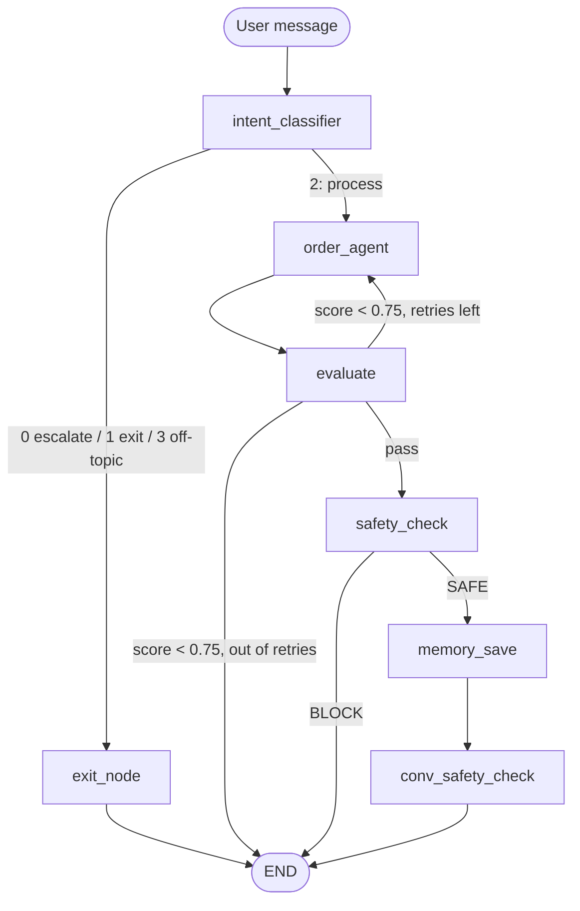

# Kartify Order Query Chatbot

An agentic customer-support assistant that answers order questions (status, delivery,
returns, replacements) from the Kartify orders database. It is built with LangGraph,
uses a ReAct tool-calling agent, scores each answer with an LLM judge, and checks it
with three guardrail layers.

This is a modular version of
`AIABA_E2E_CaseStudy_Kartify_Order_Query_Chatbot_SessionNotebook.ipynb`.

## Project layout

```
kartify_chatbot/
├── config.py           # settings (models, thresholds, "today"), credential loading
├── llm.py              # lazily-created agent LLM (gpt-4o-mini) and judge LLM (gpt-4o)
├── state.py            # OrderState TypedDict + per-turn state factory
├── memory.py           # ConversationMemory
├── database.py         # read-only SQLite queries (orders, customer orders)
├── tools.py            # @tool fetch_order_details
├── prompts.py          # every LLM prompt
├── utils.py            # JSON extraction, verdict/intent normalisation
├── agents/
│   └── order_agent.py  # ReAct loop: Thought → Action → Observation → Final Answer
├── nodes/
│   ├── agent.py        # order_agent_node, memory_node
│   ├── evaluation.py   # groundedness/precision scoring + retry router
│   ├── guardrails.py   # input (intent), output, and conversation-level guardrails
│   └── messages.py     # canned replies (escalation, exit, handoff, out-of-scope)
├── graph.py            # LangGraph wiring for one conversation turn
└── session.py          # ChatSession: drives the graph turn by turn, keeps memory
main.py                 # command-line chat
app.py                  # Streamlit web app
tests/test_offline.py   # tests with fake LLMs (no API key needed)
kartify.db              # sample orders database
```

## Workflow (one turn)



Any `BLOCK` or exhausted retries replaces the reply with a hand-off to a human agent
and ends the conversation.

## Setup

Tested with Python 3.13. The notebook's deployment guide uses 3.12.

```bash
python -m venv .venv
.venv\Scripts\activate          # Windows  (source .venv/bin/activate on macOS/Linux)
pip install -r requirements.txt
copy config.example.json config.json   # then put your real key in config.json
```

`config.json` is git-ignored. You can also set `OPENAI_API_KEY` (and optionally
`OPENAI_BASE_URL`) as environment variables instead.

## Run

The start scripts create `.venv` and install requirements on first run:

```bash
./start.sh                                       # web UI (Git Bash, macOS, Linux)
./start.sh cli --customer C1011 --order O48601   # command-line chat
start.bat                                        # web UI (Windows cmd / PowerShell)
start.bat cli --customer C1011 --order O48601
./stop.sh                                        # stop the web UI (or stop.bat)
```

Or run the pieces directly:

```bash
python main.py                                   # prompts for customer + order
python main.py --customer C1011 --order O48601   # skip the prompts
python main.py --customer C1010 --order O40327 --debug   # print every node's output
streamlit run app.py                             # web UI
```

Type `quit` to leave the CLI.

## Test

```bash
pytest
```

The tests use the real `kartify.db` and fake LLMs, so they run offline and for free.

## Deploying to Streamlit Community Cloud

Push this repo to GitHub, create an app with `app.py` as the entry point
(Python 3.12 under *Advanced settings*), and add `OPENAI_API_KEY` under
*Secrets*. Don't commit `config.json`.
